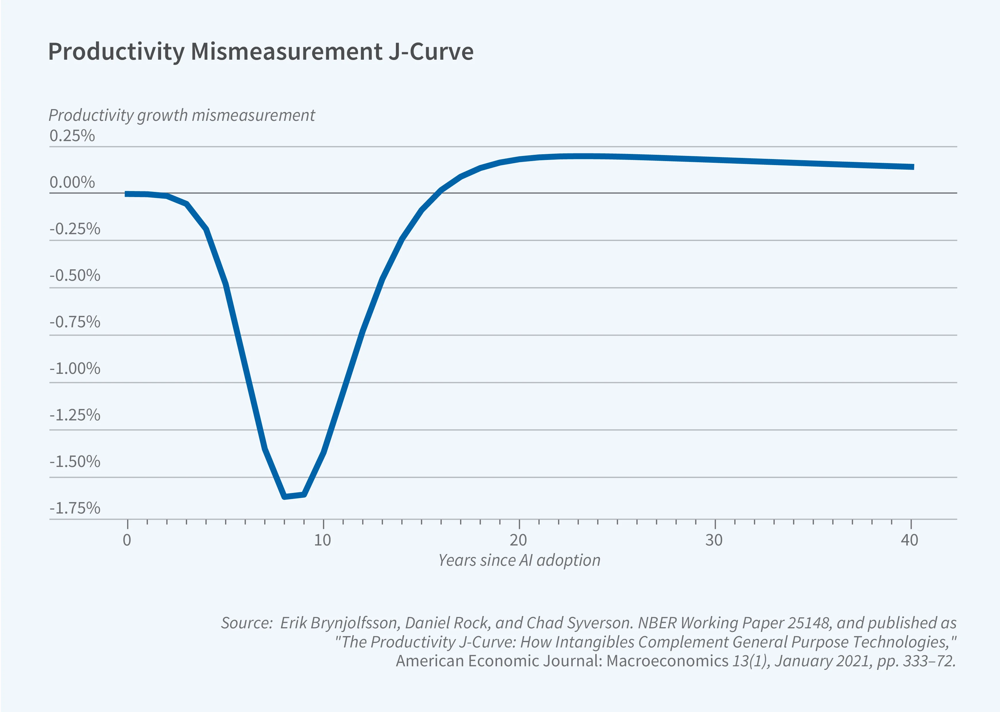

+++
title = "Solow Paradox and AI: Where Are the Productivity Gains?"
description = "The Solow paradox applied to AI: why the promised productivity gains do not show up in the statistics yet."
type = "post"
date = '2026-09-28T10:10:49+02:00'
categories = ["Article"]
tags = ["AI","Productivity","economy"]
translationKey = "ai_solow_paradox"
+++

In 1993, "The Productivity Paradox of IT"[^1] pointed out how little productivity growth had been observed despite the rise of computing, which was then hailed as a major industrial revolution.

Nobel laureate economist Robert Solow had summed up this paradox in one line: "You can see the computer age everywhere but in the productivity statistics."

Thirty years later, Solow's ghost has come back to haunt AI.

## Solow Paradox and AI

"Why can we see AI everywhere but in the productivity statistics?"

Because while many people (myself included) have no doubt that AI boosts their personal productivity, the overall factual assessment paints a more mixed picture:

- [A 2026 study by the Federal Reserve Bank of Atlanta](https://www.atlantafed.org/research-and-data/publications/working-papers/2026/03/24/03-firm-data-on-ai) covering 6,000 executives worldwide: 80% of companies report that AI has had no effect on employment or productivity over the past three years. Yet they still expect significant gains over the next three years.
- [PwC Global CEO Survey 2026](https://www.pwc.com/gx/en/news-room/press-releases/2026/pwc-2026-global-ceo-survey.html): out of 4,454 executives in 95 countries, 56% have not yet seen any significant financial benefit from AI. Only 12% report both lower costs and higher revenue.

Other studies, however, already observe significant gains among the companies using it. A [European Investment Bank study](https://cepr.org/voxeu/columns/how-ai-affecting-productivity-and-jobs-europe), for instance, estimates an average 4% improvement in labor productivity. So the paradox may not lie in the absence of gains, but in how concentrated they are and how slowly they spread.

## Productivity, an Imperfect Indicator

An individual's productivity is not a team's productivity. A team's productivity does not necessarily translate into better results for the company. And these local gains can remain invisible in the macroeconomic indicators economists rely on.

We also need to tell productivity apart from return on investment. The two notions are related, but they are not interchangeable. A technology can improve speed, quality, capacity for innovation or working conditions without immediately producing a measurable financial return. Conversely, an investment can be profitable without directly increasing output per hour worked.

**The gains already exist locally, but they remain hard to see at a global level because they require organizational change, are imperfectly measured, and are partly reinvested into additional output.**

## A Paradox With Timeless Causes

### Unrealized Gains: the Learning and Diffusion Lag

Like electricity or computing, a general-purpose technology does not deliver its main gains simply by being installed. It requires new skills, complementary investments and a reorganization of processes.

The associated productivity curve was named the "Productivity J-Curve" by Erik Brynjolfsson, Daniel Rock and Chad Syverson.

It describes a large initial investment followed by a period of stagnation, or even a decline in measured productivity, before a sharp acceleration once the complements (intangible investments, new skills, organizational restructuring) are in place.

### Mismeasured Gains

Diffusion lags explain why the gains are slow to appear. But they do not explain why some users already report saving time while objective measurements fail to confirm it. A second difficulty therefore lies in measurement itself.

#### Measurement Errors

Traditional statistical tools such as GDP and labor productivity (output per hour worked) were designed for a 20th-century industrial economy, where output was mostly tangible (cars, steel, consumer goods). Today they struggle to capture the gains AI does bring.

This is precisely what the OECD points out in [a report](https://www.oecd.org/en/publications/oecd-compendium-of-productivity-indicators-2025_b024d9e1-en/full-report/productivity-in-a-shifting-geopolitical-and-economic-landscape_7b0e7702.html): AI amplifies long-standing measurement problems. Statistics do a poor job of capturing intangible output, qualitative improvements in services and part of public sector output.

#### The Perception Gap

As with the computer in its day, the novelty effect leads users to overestimate their productivity with the new tool that AI is. By hiding the limits of how they use it, this perception can hold back their progress.

The studies seem to confirm this:
- [METR in 2025](https://blog.vibecoder.me/what-metr-study-found-about-ai-coding-productivity) found a 19% slowdown among experienced open source developers, even though they perceived the opposite. But METR now considers that this result should not be extrapolated to 2026 tools, and it can no longer cleanly measure their effect because of growing selection bias.
- [Gitclear 2024](https://arc.dev/talent-blog/impact-of-ai-on-code/) showed a jump in code churn (code thrown away or rewritten) and in duplication in code produced with AI. This trend is increasingly common today and is often referred to as "[AI slop](https://simonwillison.net/2024/May/8/slop/)".

Meta is almost a textbook case: [Mark Zuckerberg acknowledged](https://www.reuters.com/business/zuckerberg-says-ai-agent-development-going-slower-than-expected-2026-07-02/) that the company had been "super optimistic" about tools like Claude Code and that agentic development had not sped things up as expected, despite massive investments in AI infrastructure.

### Concentrated Gains That Are Hard to Interpret

The economic effects of AI are very uneven. Some companies, some jobs and some tasks may already be recording large gains, while others do not yet get any measurable benefit from it. This concentration can make the gains hard to observe in aggregate statistics: a strong improvement at a few players is diluted by adoption that is still superficial or ineffective across the rest of the economy.

The financial performance of AI providers shows where part of the value is concentrated, but it measures neither the productivity gains of their customers nor those of the providers themselves.

### Absorbed Gains: the Jevons Paradox Applied to Knowledge Work

In the 19th century, the economist William Jevons observed that making coal-fired engines more efficient did not reduce total coal consumption. By lowering the cost of using that resource, efficiency instead multiplied its uses and increased overall demand.

A similar mechanism seems to be emerging with AI. By sharply reducing the cost of producing a text, a piece of software, an analysis or an image, it does not necessarily lead us to produce the same thing in less time. Instead, it encourages us to produce more, without necessarily adding value: more content, more variants, more features and more iterations.

On top of this extra output come new tasks: selecting, checking, fixing and maintaining. The efficiency gain in generation is real, but it can be partly absorbed by these induced costs and by the low marginal value of part of what gets produced.

So AI does not necessarily eliminate work; it shifts the limit of what becomes possible, and soon expected, to produce.

"[AI slop](https://arxiv.org/abs/2603.27249)" is one visible consequence: when the cost of generation drops to almost zero, the quantity produced can grow much faster than its value.

## The Limitations Specific to AI

### From Producer to Supervisor: the Evaluation Tax

In traditional IT, the human remains the main producer, assisted by a deterministic tool (a compiler, a spreadsheet). Generative AI shifts part of that cognitive load:

The user moves from the role of main producer to that of supervisor, in charge of guiding, checking and correcting what the AI produces. Reviewing generated code or text to hunt for hallucinations, subtle bugs or contextual misreadings turns out to be cognitively exhausting.

The expected gain can then be sharply reduced, or even entirely absorbed by verification time: generating several hundred lines of code takes a few seconds, but validating that the architecture fits and that the code is correct can wipe out much of the gain, and in some cases even take longer than designing it directly.

A [longitudinal study by Vella and Blincoe, 2026](https://arxiv.org/abs/2605.23135) sharpens this observation.

The developers surveyed report spending less time writing code, but more time directing, checking and correcting what the AI produces. The researchers propose the term supervisory engineering work. In the cohort they followed, 84% still perceive a productivity gain, while the share reporting a decline in at least one dimension of their work experience rises from 14% to 27%, notably regarding cognitive load and flow state.

### Execution and Integration Costs Are Still High

In a [report published by Goldman Sachs in 2024](https://www.goldmansachs.com/images/migrated/insights/pages/gs-research/gen-ai--too-much-spend%2C-too-little-benefit-/TOM_AI%202.0_ForRedaction.pdf), Jim Covello made a particularly interesting point: replacing low-wage jobs with tremendously costly technology is almost the polar opposite of previous technology transitions.

You might expect the cost of AI to have shrunk since then, but while the unit cost of accessing a given capability is falling fast, the total cost of cutting-edge infrastructure and organizational integration can keep rising.

As with previous technologies, these costs should come down. For now, they still hold back the widespread adoption of AI.

## Conclusion

Some will perhaps read this analysis as a pessimistic view of AI, or even as a justification for their anti-AI stance.

I see it, on the contrary, as an encouraging observation. Many of today's difficulties (the learning lag, organizational change, measurement errors or an initial overestimation of the gains) already came with the rise of computing without stopping it.

This does not guarantee that AI will follow exactly the same path. But the experience gained with the Solow paradox helps us better understand why its gains are still hard to observe and, above all, how to make them more real:

- By measuring outcomes rather than mere output volume, taking into account quality, innovation and the relevance of decisions.
- By rethinking processes around what AI can do, rather than simply bolting it onto existing methods.
- By keeping its use for the tasks where the cost of verification stays lower than the gain from generation.
- By capitalizing on what we learn and by better organizing how knowledge is searched for, passed on and validated.

The next productivity lever is no longer just technological. It now depends on our ability to reorganize work around AI.

[^1]: ["The productivity paradox of information technology"](https://dl.acm.org/doi/10.1145/163298.163309) - Brynjolfsson, Erik (1993) in Communications of the ACM.
